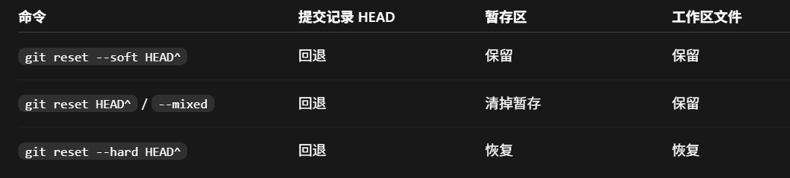
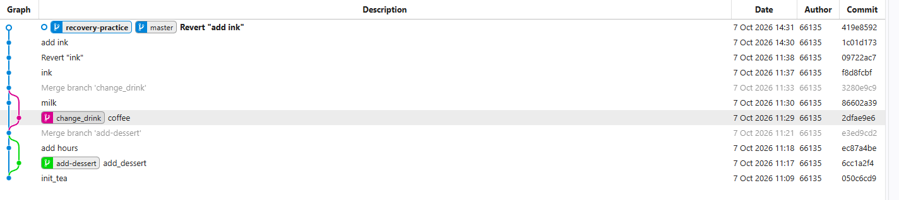

# 记录一下git的学习和使用
## 常用指令

```bash
# 初始化以及上传
git init
git add .
git commit -m "first commit"
git push

# 简单的回滚,回滚到上一个commit
git reset  HEAD^
git revert HEAD
```


    
```bash
#查看历史状态
git log --stat    

#查看当前状态
git status

#与远程同步
git push
git pull    

#分支
    
#以当前分支为基础新建分支
git checkout -b <branchname>
#列举所有的分支
git branch
#单纯地切换到某个分支
git checkout <branchname>
#删掉特定的分支
git branch -d <branchname>
#合并分支
git merge <branchname>

```


## 参考的视频
[git 学习视频](https://www.bilibili.com/video/BV134411h733/)

## 参考项目

