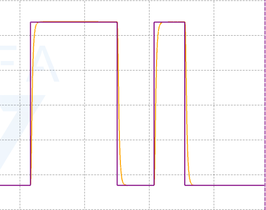

# 工作内容
> 跑通了freertos系统下的M2006速度环和位置环，控制频率1KHZ，速度pi，位置p，然后速度有一个低通滤波。然后有一个独立的串口发送线程和一个串口接收线程。
> 跑通了AI写的梯形加减速。
> 在研究RDK X5的ros2的上位机底盘控制。


---

# 论文

> 就是目前的话二分类效果比较好，然后就是要区分就是两个模型主要是能不能识别出两个ground truth标签里面更准确的，或者说时间间隔更小的模型。这个需要消融一下，然后就是跨试次的效果怎么样，主要就是同一个，一个新的试次的数据进来，识别的准确率怎么样。到时候，看看是三分类还是两分类。

---

# 新Idea
> 就是看能不能识别出莫种confuse 程度，或者是测试用户对于这个系统的理解，然后用RL啥的训练模型。主要的目的是在完成任务的情况下，保持人类对这个代码连续的心理模型
https://www.bilibili.com/video/BV1d8H668Eak/?spm_id_from=333.1391.0.0&vd_source=6a13bff8988d9cf79144c65d599cf24f

>动物强化模型训练，主要是microduck，还有螃蟹，鱼啊。看看能不能搓个蝴蝶出来


# 电机速度环与位置环理解

https://www.bilibili.com/video/BV1NgnfzVERK/?spm_id_from=333.337.search-card.all.click&vd_source=6a13bff8988d9cf79144c65d599cf24f
## 1. 电机与汽车模型的对应

汽车的简化模型：

\[
m\dot v=F-bv
\]

电机的机械模型：

\[
J\dot\omega=K_t i-B\omega-\tau_L
\]

| 汽车 | 电机 |
|---|---|
| 质量 \(m\) | 转动惯量 \(J\) |
| 推力 \(F\) | 电磁转矩 \(K_t i\) |
| 速度 \(v\) | 角速度 \(\omega\) |
| 阻力 \(bv\) | 黏性阻力矩 \(B\omega\) |

其中，\(\tau_L\) 为负载转矩。

**电流环足够快、忽略负载扰动时**，电流指令到转速可近似为一阶系统：

\[
G(s)=\frac{\Omega(s)}{I(s)}=\frac{K_t}{Js+B}
\]

实际电机还存在摩擦、延迟和限幅，因此这是简化模型。

## 2. 速度环为什么常用 PI

*为什么只用 P（比例）不够？**
    假设目标速度是 \(v_{ref}\)，当前速度是 \(v\)。
    PID 输出推力 \(F = K_p \cdot (v_{ref} - v)\)。
    代入方程：\(K_p \cdot (v_{ref} - v) - b \cdot v = m \cdot \dot{v}\)。
    当系统稳定时，加速度 \(\dot{v} = 0\)，也就是：
    \[
K_p \cdot (v_{ref} - v) = b \cdot v
\]
    你会发现，\(v\) 永远不可能等于 \(v_{ref}\)。因为要克服阻力 \(b \cdot v\)，必须保留一定的误差 \((v_{ref} - v)\) 来产生推力。这就是**稳态误差**。


加入 I 后，**误差为零时积分停止变化，但积分输出仍可以非零**，因此电机能保持所需转矩。

## 3. 位置环为什么常用 P 

串级控制结构：

```text
位置误差 → 位置 P → 目标速度
速度误差 → 速度 PI → 目标电流
电流误差 → 电流控制器 → 电机
```

位置 P 的输出为：

\[
\omega_{\mathrm{ref}}=K_{p,\theta}(\theta_{\mathrm{ref}}-\theta)
\]

距离目标越远，目标速度越大；接近目标时减速；到点后目标速度为零。

**位置外环常用 P，主要因为内部速度 PI 已经负责速度跟踪和负载补偿。** 到点后，速度环的积分输出仍可提供保持电流。

如果位置 P 直接输出电流，没有内部速度 PI，恒定负载通常会造成位置静差。

## 4. 电流与运动的关系

\[
i=\frac{J\dot\omega+B\omega+\tau_L}{K_t}
\]

电流既用于产生加速度，也用于克服阻力和负载。因此，**匀速时可能需要电流，静止保持时也可能需要电流**。