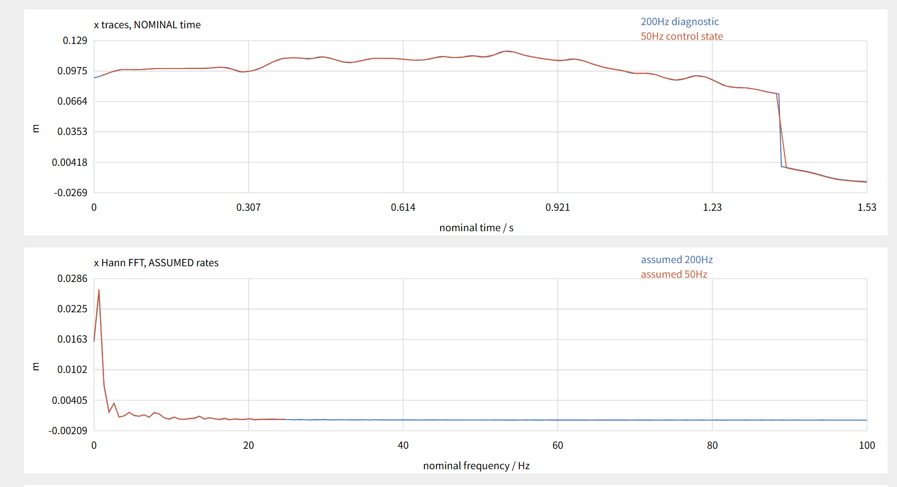
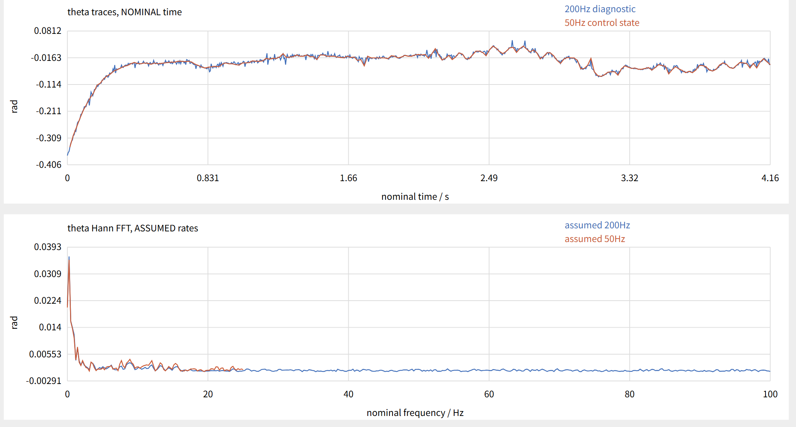
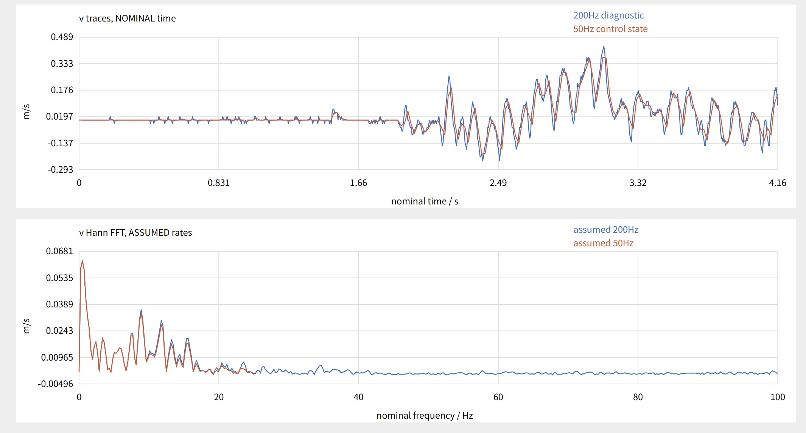
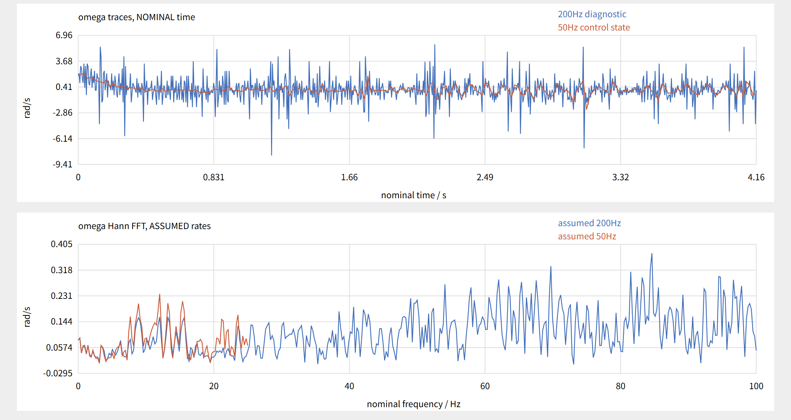
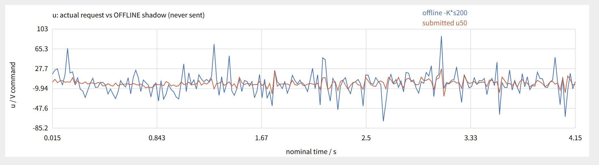

# 学习笔记  
>  PID电机位置控制轨迹跟踪，可以在目标位置设置死区，然后对D滤波放置震荡
>  然后就是在轨迹跟踪的过程中，注意PID中D的含义的变化。原本D在位置环，也就是r不变，则\(\dot{r} = 0\)。本质上是对速度的惩罚，也就是在速度大的时候，降低速度，也就是增加系统的阻尼。
>  而对于轨迹跟踪，因为目标位置变化，所以\(\dot{r}  != 0\),也就是有一个前馈的效果。当位置变化大的时候，提前补偿一部分。
$$\dot{e} = \dot{r} - \dot{x}$$

# 工作完成：
> 完成了通过上位机控制倒立摆,32程序01_HAL_STM32，然后上位机程序upper_programs，主要有GUI的和没有GUI的版本。
> 测试采样的频率的代码写完了。

# 待研究/实现
> - [x] 现在是同一个LQR的K矩阵，然后一个X的采样是200HZ，控制是50HZ，用最后一组数据，LQR震荡严重。改成采样50HZ，控制50HZ就稳定了。（怀疑是采样频率的问题，导致速度和角速度震荡严重，可以加个滤波看看，然后可以尝试将LQR的离散间隔改成5ms）
> 26/10/7
> 理论分析后放弃提高LQR的控制频率，原因是差分会放大两次测量的误差。\[\theta_{\text{测量},k}=\theta_{\text{真实},k}+e_k\]\[\hat\omega_k=\underbrace{\frac{\theta_{\text{真实},k}-\theta_{\text{真实},k-1}}{T}}_{\text{这段时间的真实平均角速度}}+\underbrace{\frac{e_k-e_{k-1}}{T}}_{\text{测量误差造成的角速度}}\]
> 

---
> - [x] 试一下git回溯文件的功能
> 26/10/7
> 见Learning_git文件夹。
---
> - [x] 它这个并联PID相当于\[u=-K_x(x-x_r)-K_v\dot x-K_\theta\theta-K_\omega\dot\theta\],就是搓了一个LQR出来，然后可以通过时间啥的具体看一下对应的LQR的K矩阵怎么样。
>理论上是近似的，但是它的位置和角度的更新频率一个是40HZ，一个是200HZ，不能与LQR在用一个时间尺度离散解出来的K相比较。而且还有一些低通什么的滤波处理。
> #### 对于上面两个问题提出的就是每个观测量的观测频率不同，可以由观测器（卡尔曼滤波）来估计，然后统一LQR处理，也可以去研究一下多速率LQR啥的。
---
> - [ ] 用MAtlab研究一下并PID和串PID，以及具体加减法对这个直线倒立摆的控制的印象。