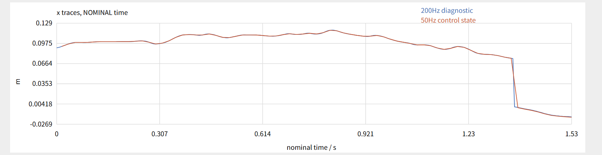
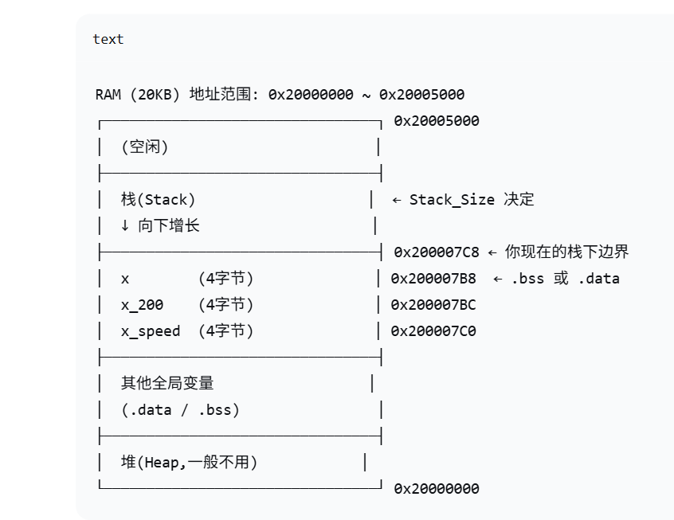

# 睡过了，闹钟响了，但是人没醒，旷工一次。

# 问题解决：

> #### 在测试50HZ采样和200HZ采样的时候，倒立摆会有一个突然的失灵，在1.3s左右。
> #### 序号167，位置0.074601，速度-0.086998；序号168，位置-0.001522，速度-0.076123。168号位置应该为0.074601 + (-0.076123 × 0.020)≈ 0.073079 m,结果0.074601消失。
> 
> #### 然后在ChatGPT的帮助下，定位到了这个问题是由于栈（RAM中用于临时存储函数调用的数据的地方）溢出导致的，也就是栈满了，然后压栈覆盖了原本存储的x,x_200等变量，导致位置解算错误，倒立摆失控。<br>
> #### 解决就是在startup_stm32f103xb.s中，将栈的大小从1024字节增加到4096字节，即可解决这个问题。
```Cpp
    Stack_Size EQU 0x400    ; 1024 字节

    Stack_Size EQU 0x1000
```
---
> #### 然后就是